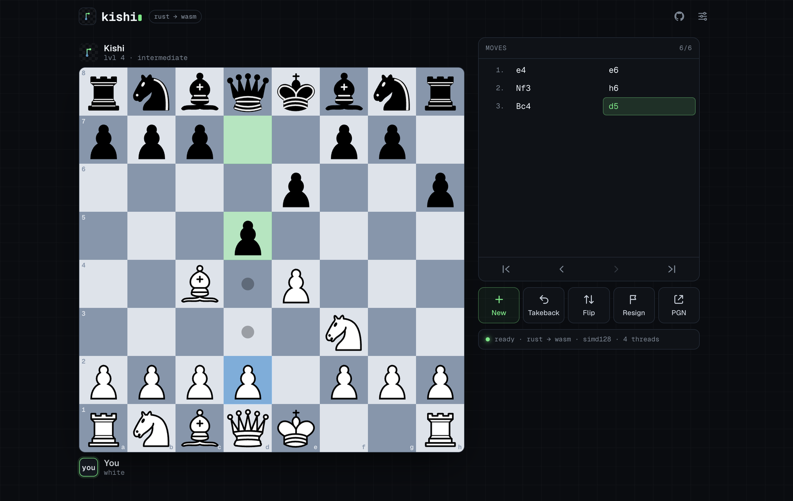
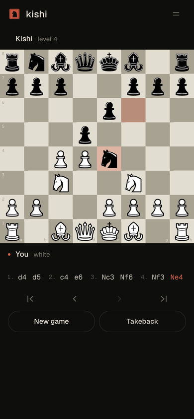

<p align="center">
  <picture>
    <source media="(prefers-color-scheme: dark)" srcset="docs/brand/kishi-lockup-light.svg">
    
  </picture>
</p>

<p align="center"><b>Chess and shogi against engines written in Rust, compiled to WebAssembly, running on your device.</b><br>
Quiet, offline once installed, and multi-threaded in the browser. Go is next.</p>

<p align="center">
  <a href="https://kishi.raskell.io"><b>Play at kishi.raskell.io</b></a> ·
  <a href="#how-it-plays">Chess</a> ·
  <a href="#shogi">Shogi</a> ·
  <a href="#how-it-learns-self-play">How it learns</a> ·
  <a href="#strength">Strength</a> ·
  <a href="#build">Build</a>
</p>

<p align="center">
  
</p>

Kishi (騎士, *knight*) is a chess engine written from scratch in Rust. The page
renders the board; the engine thinks in Web Workers on your machine, with no
server and no account. On an iPhone, open the site in Safari and choose
**Share → Add to Home Screen** for a full-screen app that works offline.



## How it plays

- **Board and rules.** Bitboards with magic move generation, verified by perft
  against the standard suite. Positions are small and `Copy`, so making a move
  returns a new one and the search never unmakes.
- **Search.** Iterative-deepening principal variation search with aspiration
  windows, a lock-free transposition table, null-move pruning, reverse futility
  pruning, razoring, late move reductions and pruning, singular extensions,
  static exchange evaluation, pawn-structure correction history, and killer,
  counter-move, history and continuation-history move ordering.
- **Threads.** Lazy SMP: helper threads search the same tree and share what they
  find through the transposition table. In the browser they are Web Workers
  sharing the engine's WebAssembly memory (`kishi-mt.wasm`, built with nightly
  `build-std` and atomics). GitHub Pages cannot send the cross-origin isolation
  headers that shared memory needs, so the service worker adds them.
- **Evaluation.** An NNUE network: (768 → 512) × 2 perspectives → 1, squared
  clipped ReLU, eight output buckets by piece count. The first layer is an i16
  accumulator updated incrementally as moves are made; the output layer runs in
  f32 with SIMD. Until a network beats it, the engine plays with a hand-written
  evaluation (PeSTO's tapered piece-square tables).
- **Levels.** Levels 1 to 6 score every legal move and pick one at random,
  favouring the better ones (a softmax whose temperature falls from 300 to 12
  centipawns). Levels 7 and 8 think for 0.8 s and 2.5 s at full strength, and
  vary their openings from a small book of main lines.

<br clear="right">

## Shogi

Switch games from the menu. The shogi engine (`shogi/`) is its own crate on the
same plan as the chess one:

- **Rules.** A 9×9 mailbox with both hands; drops, promotion (forced where a
  piece could never move again), nifu, and the pawn-drop mate ban (uchifuzume),
  verified by perft against the published counts: 19,861,490 positions at depth
  5 from the start, and 4,809,015 at depth 3 from the drop-heavy "matsuri" test
  position.
- **Search.** Principal variation search with a transposition table (Kishi's
  own, shared with chess), null-move and reverse futility pruning, late move
  reductions and pruning, killers and history, captures-only quiescence, and
  check extensions. About 2.3M nodes a second natively.
- **Evaluation.** Material, with pieces in hand worth a little more than on the
  board; king shelter by golds and silvers; pressure from pieces near the
  enemy king; mobility of bishops and rooks.
- **Board.** The same squares and coordinates as the chess board, nine to a
  side; the pieces are drawn by Kishi itself: pentagons lettered in the device's
  Japanese serif, promoted pieces in vermilion, gote's pieces turned to face
  sente. Pieces in hand sit in each player's row; tap one to drop it. Moves are
  written in Western notation (P-7f, Bx2b+, S*5e), and a game copies as a
  numbered record plus the USI line any engine or lishogi loads.

Against Fairy-Stockfish 14 at 0.5 s a move, Kishi's shogi engine scores 20/20
at skill level 0 and 2/20 at skill level 10.

## How it learns: self-play

The network is trained by a reinforcement loop, all in Rust (`tools/`):

```text
 ┌─────────────┐  positions, scores,  ┌─────────────┐  new network  ┌─────────────┐
 │   datagen   │ ───── results ─────▶ │    train    │ ────────────▶ │    arena    │
 │  self-play  │                      │ predict the │               │ vs previous │
 └─────────────┘                      │   outcome   │               │ generation  │
        ▲                             └─────────────┘               └──────┬──────┘
        └──────────────── the stronger player plays the next games ────────┘
```

1. **Play.** The current engine plays itself from random openings, about 5,000
   nodes a move. Every quiet position is recorded with the search's score and,
   once the game ends, its result.
2. **Learn.** A new network learns to predict the outcome. Its target blends the
   search score, as a win probability, with the actual result: the result is the
   reinforcement signal that lets each generation correct the evaluation that
   played the games. The score-to-probability scale is fitted to the data, so the
   network speaks the same centipawns as the search's pruning margins.
3. **Test.** The new network plays the previous one in paired games, and the
   loop repeats with the stronger player.

`scripts/generation.sh N` runs one generation; [`nets/LOG.md`](nets/LOG.md)
records how each one fared.

## Strength

Measured natively against Stockfish 19 set up the way lichess's computer levels
are (skill level, depth limit and think time per level), 20 games each:

| Opponent | Kishi, hand-written eval |
|---|---|
| lichess level 4 | 19 / 20 |
| lichess level 6 | 13 / 20 |
| lichess level 7 | ½ / 20 |

Generation 1, trained on 5.6M self-play positions, beats the hand-written
evaluation by 85 Elo at equal nodes, but is about even at equal time because it
is 2.5 times slower per node. The app switches to a network once one wins at
equal time.

## Build

```sh
make serve          # web/kishi.wasm (+ kishi-mt.wasm with nightly), served on :8647
make test           # perft (chess and shogi), notation, search, SEE and book tests
make bench          # native search speed
```

The tools, run with `cargo run --release -p kishi-tools --bin <name>`:

| Tool | Does |
|---|---|
| `kishi` | UCI engine for chess GUIs (`--net file` or `--hce`; `Threads`, `Hash`) |
| `datagen` | self-play games to training records |
| `train` | trains a network on records, writes `.nnue` |
| `arena` | two evaluations play paired games, prints the Elo difference |
| `vs` | Kishi against a UCI engine, such as Stockfish set up like lichess's levels |
| `shogi-vs` | Kishi's shogi engine against a USI engine (Fairy-Stockfish) |

Every push to `main` tests, builds both engines and deploys the site to GitHub
Pages (`.github/workflows/pages.yml`). The brand marks, a knight cut into a
vermilion name seal (hanko), are generated by `scripts/brand.py`; the social card is `scripts/og.html`.

## Credits

Pieces: Chessnut by Alexis Luengas (Apache 2.0). Type: Geist and Geist Mono by
Vercel (SIL OFL). Hand-written evaluation tables from
PeSTO by Ronald Friederich.

Code: MIT.
