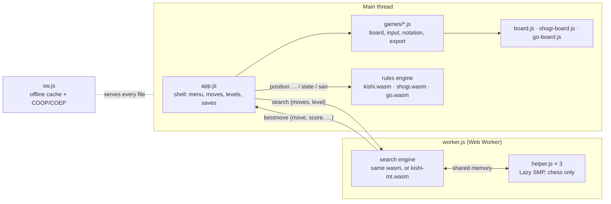

# Architecture

Kishi runs entirely in the browser. Each game is a Rust crate that compiles to
a small WebAssembly module with a one-function text interface; the page loads
that module twice, once on the main thread to know the rules and once in a
worker to think.

## The crates

| Crate | Path | What it is |
|---|---|---|
| `kishi-engine` | `engine/` | Chess. Also hosts code the others reuse: the lock-free transposition table, the clock (`now_ms`), the random generator. |
| `kishi-shogi` | `shogi/` | Shogi, on the same search plan as chess. |
| `kishi-go` | `go/` | Go on 19×19, with Monte Carlo tree search. |
| `kishi-tools` | `tools/` | Native binaries for playing, training and measuring. Never shipped to the browser. |

Each game crate has a `web` feature. With it, `src/web.rs` exports the C ABI the
page calls (see [the protocol](protocol.md)); without it the crate is a plain
library that the tools and tests use.

## The builds

`make build` produces, in `web/`:

| File | From | Notes |
|---|---|---|
| `kishi.wasm` | `engine`, feature `web` | Chess, single-threaded. The embedded network is `nets/kishi.nnue` (empty means the hand-written evaluation). |
| `kishi-mt.wasm` | `engine`, feature `threads` | Chess with shared memory and helper threads. Needs a nightly toolchain with `rust-src` (`-Z build-std`); skipped otherwise. |
| `shogi.wasm` | `shogi`, feature `web` | Shogi, single-threaded. |
| `go.wasm` | `go`, feature `web` | Go, single-threaded. |

All are built for `wasm32-unknown-unknown` with `simd128`, `bulk-memory` and
`nontrapping-fptoint` (`.cargo/config.toml`), then passed through `wasm-opt -O3`.
The only import is `env.kishi_now`, a millisecond clock the page provides; the
threaded build also imports its memory.

## One move, end to end

1. You tap a square. The game module (`games/chess.js`, `shogi.js` or `go.js`)
   turns the tap into a move string, asking for a promotion or confirming a
   stone where needed.
2. The shell asks the rules engine for its notation (`san`), appends both to the
   game, saves it in `localStorage`, and asks for the new `state` (legal moves,
   check, result).
3. If it is Kishi's turn, the shell posts `{type: "search", moves, level}` to the
   worker, which sets the position and runs `go level N`.
4. The worker answers with the move and what the search found; the shell waits
   at least 350 ms (so the reply never feels abrupt) and plays it the same way.

The shell never knows the rules of any game: everything it needs comes from the
rules engine's JSON or from the game module (see [the web app](../web/docs/README.md)).

## Offline and threads

`sw.js` caches every file of the app and serves it cache-first, refreshing in
the background, so the app works offline once loaded and updates on the next
visit. It also adds `Cross-Origin-Opener-Policy` and
`Cross-Origin-Embedder-Policy` to every response: GitHub Pages cannot send
headers, and without them the browser refuses `SharedArrayBuffer`, which the
threaded chess engine needs. The first visit therefore reloads once, after the
service worker installs.
